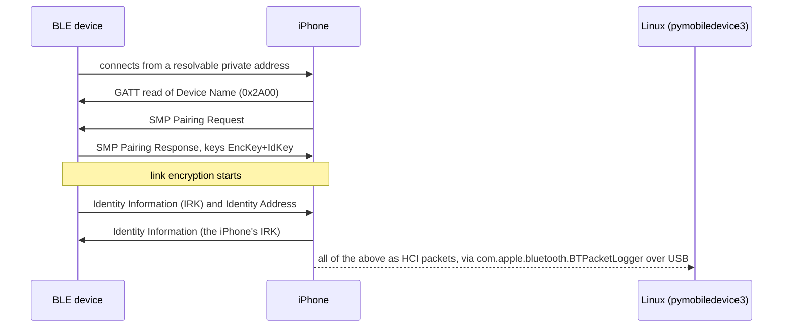

# irk-extract

Gets a Bluetooth LE device's IRK (Identity Resolving Key) out of an iPhone bond, over USB, without
a jailbreak.

Most BLE wearables and trackers hide behind resolvable private addresses that change every few
minutes. Only someone holding the device's IRK can tell that `51:13:7D:09:09:2B` and the next
random-looking address are the same band. Home Assistant's
[Private BLE Device](https://www.home-assistant.io/integrations/private_ble_device/) integration
(and [Bermuda](https://github.com/agittins/bermuda) on top of it) can follow such a device from
room to room, as long as you give it that IRK.

The IRK only travels once, while the device pairs, and iOS keeps it in the keychain where nothing
short of a jailbreak can read it. But with Apple's Bluetooth logging profile installed, the iPhone
streams its HCI traffic over USB, and HCI sits below the link encryption: when the device re-pairs,
the SMP key distribution shows both sides' IRKs in the clear. `irk-extract` walks you through that
capture and picks the key out.

```
         📱 Capturing from iPhone99,1, iOS 99.0, Test Chip
08:00:00 🔗 Connected to 51:13:7D:09:09:2B (resolvable private)
08:00:00 🎯 51:13:7D:09:09:2B is Google Fitbit Air (from its GATT Device Name)
08:00:00 🤝 Pairing Request from the iPhone (KeyboardDisplay): it offers EncKey+IdKey+LinkKey
            and asks Google Fitbit Air for EncKey+IdKey+LinkKey
08:00:00 🤝 Pairing Response from Google Fitbit Air (NoInputNoOutput): LE Secure Connections,
            Just Works. Google Fitbit Air will send EncKey+IdKey, the iPhone IdKey
08:00:00 🔄 Exchanging public keys (LE Secure Connections)
08:00:00 🔒 Link to Google Fitbit Air encrypted with the new keys
08:00:00 🔑 Google Fitbit Air sent its IRK (resolves 51:13:7D:09:09:2B ✓)
08:00:00 📍 Google Fitbit Air's identity address: C0:FF:EE:12:34:56 (random static)
08:00:00 🔑 The iPhone sent its own IRK
08:00:00 📍 iPhone's identity address: F0:0D:F0:0D:00:01 (public)
╭──────────────────────────────── 🎉 IRK for Google Fitbit Air ────────────────────────────────╮
│                                                                                              │
│                 Device  Google Fitbit Air  matched by GATT Device Name                       │
│            Paired from  51:13:7D:09:09:2B (resolvable private)                               │
│       Identity address  C0:FF:EE:12:34:56 (random static)                                    │
│              IRK (hex)  00112233445566778899aabbccddeeff                                     │
│           IRK (base64)  /+7dzLuqmYh3ZlVEMyIRAA==                                             │
│                  Check  ✓ ah(IRK, 51:13:7D) = 09:09:2B: resolves 51:13:7D:09:09:2B           │
│                                                                                              │
│     iPhone's IRK (hex)  0f1e2d3c4b5a69788796a5b4c3d2e1f0                                     │
│  iPhone's IRK (base64)  8OHSw7Sllod4aVpLPC0eDw==                                             │
│      iPhone's identity  F0:0D:F0:0D:00:01 (public)                                           │
│                                                                                              │
╰──────────────────────────────────────────────────────────────────────────────────────────────╯
```

(Every key and address above is synthetic.)

## What you need

- Linux with [usbmuxd](https://github.com/libimobiledevice/usbmuxd) (`sudo pacman -S --needed usbmuxd`,
  `sudo apt install usbmuxd`, …) and [uv](https://docs.astral.sh/uv/). macOS should work too, since
  usbmuxd is built in there, but only Linux is tested.
- The iPhone and a USB cable. No jailbreak, Developer Mode or tunnel:
  [pymobiledevice3](https://github.com/doronz88/pymobiledevice3)'s `btlogger` works over plain
  usbmuxd, and irk-extract runs it through `uvx`.
- Apple's **Bluetooth for iOS** logging profile, `iOSBluetoothLogging.mobileconfig`. Apple only hands
  it out after an Apple ID sign-in on
  [Profiles and Logs](https://developer.apple.com/bug-reporting/profiles-and-logs/?name=bluetooth),
  so it isn't bundled here. Download it once and irk-extract installs it over USB.
- The device you're after, and a way to pair it again (usually its own app).

## Usage

```bash
uv run https://raw.githubusercontent.com/ovflowd/irk-extract/main/irk_extract.py
```

Or install it as a tool:

```bash
uv tool install git+https://github.com/ovflowd/irk-extract
irk-extract
```

It walks you through six steps:

1. **Preflight.** Checks that usbmuxd runs, finds the iPhone over USB and makes sure it trusts this
   computer (tap Trust on the phone when it asks). It never runs `sudo` itself: if usbmuxd is
   missing, it prints the command for you to run.
2. **Logging profile.** Looks for Apple's Bluetooth logging profile and, if it's missing, sends the
   `.mobileconfig` you downloaded to the iPhone. When iOS wants a confirmation on the phone, it tells
   you where (Settings → Profile Downloaded → Install) and waits until the profile shows up.
3. **Which device.** The name the iPhone shows in Settings → Bluetooth, e.g. `Google Fitbit Air`.
4. **Capture and re-pair.** Starts `pymobiledevice3 btlogger` and checks that HCI traffic flows
   (a steady stream with the profile, not a single byte without it). Then you Forget the device in
   Settings → Bluetooth and pair it again from its app, while irk-extract narrates the connection,
   the SMP Pairing Request and Response, encryption and the key distribution.
5. **Result.** The device's IRK in hex and base64, its identity address, the check that the IRK
   resolves the address it paired from, and the iPhone's own IRK from the same exchange. Paste
   either form into Settings → Devices & services → Add integration → Private BLE Device.
6. **Clean up.** Stops the capture, also on Ctrl-C, and offers to remove the profile again.

| Option | |
|---|---|
| `--name NAME` | The device's name, so it doesn't have to ask |
| `--profile FILE` | The `.mobileconfig` to install if the profile is missing |
| `--out FILE` | Where to save the capture (default `./irk-capture-<time>.pklg`) |
| `--udid UDID` | Which iPhone, when more than one is plugged in |
| `--replay FILE` | Narrate a saved `.pklg`, or every `.pklg` in a sysdiagnose `.tar.gz`, instead of capturing |

### Replaying a capture

`--replay` runs the same narration and result over a saved capture, so you can go back to an old
one or dig through a sysdiagnose. Without `--name` it lists every device that sent an IRK.

```bash
irk-extract --replay irk-capture-20261103-172241.pklg --name "Google Fitbit Air"
```

## How it works



A few details matter:

- **Finding the device by name.** iOS logs its scan results as Apple vendor events rather than
  standard advertising reports, so a name rarely sits next to an address. irk-extract ties the name
  to a connection through the iPhone's GATT read of Device Name (`0x2A00`) on that connection, a
  standard advertising report when there is one, or Apple's vendor scan event that carries both the
  name and the address. If none of those link a pairing to the name, it lists every device that sent
  an IRK and lets you pick.
- **Byte order.** SMP sends the IRK least significant byte first. The hex irk-extract prints is
  reversed, most significant byte first, which is the AES key Home Assistant expects. The base64 is
  of the bytes as sent, the way iOS keeps it in the keychain ("Remote IRK"), and Home Assistant
  reverses base64 input, so both forms give the same key.
- **The check.** A resolvable private address is `prand || hash` with `hash = ah(IRK, prand)`
  (Bluetooth Core Vol 3 Part H 2.2.2). irk-extract recomputes it for the address the device paired
  from, so a wrong byte order or the wrong key shows up right away.
- **Noise.** iOS keeps starting and cancelling background connections, which show up as LE
  Connection Complete with status `0x02` and peer `00:00:00:00:00:00`. They're counted and hidden.

## Troubleshooting

- **No traffic after starting the capture.** The logging profile isn't active. Check that Settings →
  General → VPN & Device Management lists Bluetooth Logging, toggle Bluetooth off and on, or restart
  the iPhone.
- **"encrypted with keys from an existing bond".** The iPhone still remembers the device and
  reconnected with the old keys. Forget it in Settings → Bluetooth first: keys only travel while
  pairing.
- **"No IRK coming".** The device's Pairing Response doesn't offer an IdKey, so it will never send
  an IRK. Devices like that don't use resolvable private addresses, so track their address directly.
- **Pairing failed.** irk-extract prints the SMP reason and what usually helps, like resetting the
  device's own pairing for "Unspecified Reason".
- **usbmuxd isn't running.** udev usually starts it when an iPhone is plugged in and stops it when
  the last one is unplugged, so plugging the iPhone in again is often enough.

## Privacy

A capture is a full HCI log. It holds the IRKs and LTKs of everything that paired while it ran, the
iPhone's own IRK, and the addresses of devices around you. irk-extract writes it with `0600`
permissions and never sends it anywhere. Don't share it, delete it once you've copied the key, and
remove the logging profile when you're done.

Apple's profile isn't redistributed here, and nothing in this repo is a real key: the tests run on
synthetic traces.

## Development

```bash
uv sync
uv run pytest
uv run ruff check . && uv run ruff format --check .
```

The tests build PacketLogger traces from scratch (`tests/synth.py`) and drive the whole guided flow
against a fake `pymobiledevice3` (`tests/fake_pmd3.py`). `IRK_EXTRACT_PMD3` points irk-extract at
any pymobiledevice3 command. To check a real capture of your own, set `IRK_EXTRACT_REAL_TRACE` and
`IRK_EXTRACT_REAL_NAME` and run `tests/test_real_capture.py`.

Built against captures from an iPhone on iOS 27.2 pairing a Google Fitbit Air. Not affiliated with
Apple or Google.

## License

[MIT](LICENSE)
